# Le tutoriel d'hier devient un agent — le site

**Le site en ligne : [www.darkdatagent.art](http://www.darkdatagent.art/)**

C'est la vitrine construite depuis `soussol-v2/` (landing, pipeline, storyboard,
skills, pupitre de démo, banc, reçus des runs, dérives). L'application locale,
qui lance le pipeline et l'agent, tourne sur votre machine avec `make` (plus bas).

Vitrine du projet pour le hackathon H Company × 42AI (7–8 novembre 2026) :
landing pour le jury, atelier pour suivre le pipeline (storyboard, skills
induits, pupitre de démo, banc, rapport de dérive). Le site est en anglais.

Le produit est l'agent qui **fait la tâche selon les règles de la maison** ;
l'audit de dérive est la couche qui **répare** ces règles quand le logiciel
change. « Votre archive devient des agents qui font le travail selon vos
règles, et qui vous préviennent quand une vidéo ne leur suffit plus. »

La doc du projet (SETUP, ARCHITECTURE, PLAN, BENCH, PITCH, LANDING) est sur la
branche `docs/kickoff`, pas ici. Ce qui reste à faire est dans `A_FAIRE.md`.
Le pipeline qui produit `work/` est dans `scripts/` (voir `scripts/README.md`).

## Architecture

```mermaid
flowchart TD

subgraph group_web["Site and onboarding"]
  node_routes["URL routing<br/>[urls.py]"]
  node_views["Web views<br/>[views.py]"]
  node_project["Project manager<br/>[projects.py]"]
  node_keys["API key setup<br/>[keys.py]"]
  node_software["Software discovery<br/>[software.py]"]
  node_showcase["Showcase data<br/>[data.py]"]
end

subgraph group_pipeline["Tutorial pipeline"]
  node_work["Project and run files"]
  node_transcribe["Transcription<br/>[20_transcribe.py]"]
  node_keyframes["Keyframe extraction<br/>[30_keyframes.py]"]
  node_storyboard["Storyboard creation<br/>[40_storyboard.py]"]
  node_induce["Skill induction<br/>[50_induce.py]"]
  node_register["Agent registration<br/>[60_register.py]"]
  node_common["Pipeline helpers<br/>[common.py]"]
end

subgraph group_agent["Agent execution"]
  node_run["Task runner<br/>[70_run_one.py]"]
end

subgraph group_audit["Evaluation and repair"]
  node_verify["Run verification<br/>[80_verify.py]"]
  node_repair["Drift repair<br/>[75_repair.py]"]
  node_bench["Benchmark runner<br/>[90_bench.py]"]
  node_report["Report generation<br/>[95_report.py]"]
  node_reports["Benchmark outputs"]
end

node_user(("Local user"))
node_gladia{{"Gladia API"}}
node_hapi{{"H platform"}}
node_target{{"Target web software"}}
node_dolibarrdb[("Dolibarr database")]

node_user -->|"visits"| node_routes
node_routes -->|"routes to"| node_views
node_views -->|"reads display data"| node_showcase
node_views -->|"manages projects"| node_project
node_views -->|"checks and saves keys"| node_keys
node_views -.->|"detects software"| node_software
node_views -->|"shows project progress"| node_work
node_user -.->|"submits tutorial"| node_transcribe
node_transcribe -.->|"transcribes audio"| node_gladia
node_transcribe -.->|"produces transcript"| node_keyframes
node_keyframes -.->|"extracts frames"| node_storyboard
node_storyboard -->|"supplies storyboard"| node_induce
node_induce -->|"induces skill"| node_hapi
node_induce -->|"writes skill files"| node_work
node_register -->|"registers agent"| node_hapi
node_register -->|"records agent metadata"| node_work
node_common -->|"reads and writes"| node_work
node_common -->|"calls Models API"| node_hapi
node_user -->|"starts task run"| node_run
node_run -->|"starts agent session"| node_hapi
node_run -->|"performs task in"| node_target
node_run -->|"writes run record"| node_work
node_run -->|"checks run result"| node_verify
node_verify -->|"reads SQL verdict"| node_dolibarrdb
node_user -->|"requests repair"| node_repair
node_repair -->|"revises skill"| node_work
node_user -->|"starts benchmark"| node_bench
node_bench -->|"runs benchmark arms"| node_run
node_bench -->|"verifies benchmark runs"| node_verify
node_bench -->|"optionally repairs drift"| node_repair
node_bench -->|"writes benchmark CSV"| node_reports
node_report -->|"reads run records"| node_work
node_report -->|"writes analysis"| node_reports
node_views -->|"shows benchmark and drift"| node_reports

classDef toneNeutral fill:#f8fafc,stroke:#334155,stroke-width:1.5px,color:#0f172a
classDef toneBlue fill:#dbeafe,stroke:#2563eb,stroke-width:1.5px,color:#172554
classDef toneAmber fill:#fef3c7,stroke:#d97706,stroke-width:1.5px,color:#78350f
classDef toneMint fill:#dcfce7,stroke:#16a34a,stroke-width:1.5px,color:#14532d
classDef toneRose fill:#ffe4e6,stroke:#e11d48,stroke-width:1.5px,color:#881337
classDef toneIndigo fill:#e0e7ff,stroke:#4f46e5,stroke-width:1.5px,color:#312e81
classDef toneTeal fill:#ccfbf1,stroke:#0f766e,stroke-width:1.5px,color:#134e4a
class node_routes,node_views,node_project,node_keys,node_software,node_showcase,node_user toneBlue
class node_work,node_transcribe,node_keyframes,node_storyboard,node_induce,node_register,node_common,node_dolibarrdb toneAmber
class node_run,node_gladia toneMint
class node_verify,node_repair,node_bench,node_report,node_reports toneRose
class node_hapi,node_target toneIndigo
```



Le front est volontairement nu : HTML sémantique, CSS minimal, aucune police.
Seules exceptions : le bandeau jaune des alertes et le défilement du storyboard
sur `/projects/<id>/`. La mise en forme vient dans un second temps.

Le site **lit** `work/` et `report/`. Il a aussi une partie application, locale
seulement (refusée à toute autre machine) :

`make` ouvre `/start/`, qui mène là où on en est, comme une appli qu'on
installe :

1. `/welcome/` : accueil, ce que fait l'appli en trois lignes, un bouton.
   Tant que les comptes ne sont pas connectés.
2. `/setup/` (étape 1 sur 2) : les clés Gladia et H, vérifiées auprès des
   services, écrites dans `.env`.
3. `/new/` (étape 2 sur 2) : ajouter une vidéo (fichier ou lien YouTube),
   choisir le logiciel web (le Dolibarr de démo, avec un bouton pour le
   démarrer, une appli détectée sur la machine, ou une adresse tapée), lancer.
   Le pipeline tourne en arrière-plan (`scripts/run_project.py`).
4. `/projects/<id>/` : l'avancement étape par étape, le journal, ce que
   le modèle de H a compris du tutoriel (étapes avec libellés exacts,
   champs, règles, corrections de la transcription, ce qui a sans doute
   changé), le skill écrit, le storyboard. Le storyboard est replié derrière
   un bouton ; ouvert, il défile seul, une capture à la fois (pause au survol,
   flèches, swipe). Une capture porte une alerte ⚠ quand sa phrase demande
   quelque chose avant de continuer : être connecté, activer un module, avoir
   les droits (`_storyboard_with_warnings` dans `atelier/views.py`). Tant
   qu'une étape ou un run tourne, la page se met à jour seule toutes les 3 s
   sans se recharger : seuls l'état, les étapes, les runs et le journal sont
   remplacés, et rien ne bouge pendant qu'on tape une tâche. Puis l'agent,
   enregistré chez H avec ce skill : « Run the agent » (une facture de `data/factures.csv`
   ou une tâche libre, avec ou sans le skill) ouvre un Chrome sur cette
   machine et fait la tâche dans le logiciel choisi ; chaque run est listé
   avec son verdict lu dans la base Dolibarr, le direct et le replay H.
5. `/start/` une fois une vidéo ajoutée : la liste des vidéos et leur état,
   les comptes, « Add a video ».

Les anciennes adresses `/keys/` et `/start/dolibarr/` redirigent. La vitrine
(`/` et les pages du pipeline) montre des données d'exemple (`atelier/data.py`)
tant que `report/bench.csv` n'a pas de run vérifié, puis lit les vraies sorties
de `work/` et `report/`.

```bash
make           # installe tout, lance le site et ouvre http://127.0.0.1:8000/start/
make install   # crée .venv et installe Django, gladiaio-sdk, yt-dlp, requests
make run       # lance le site au premier plan : http://127.0.0.1:8000
make start     # le lance en arrière-plan (make stop, make status, make logs)
make restart   # l'arrête et le relance
make update    # git pull + dépendances + migrate + collectstatic, relance s'il tournait

make dolibarr  # Dolibarr de démo sur http://localhost:8080, pré-rempli
make chrome    # le Chrome de l'agent, port 9222

make prep ID=JZMgB1UItkk         # étapes 1 à 4 du pipeline pour une vidéo
make register ID=…               # le skill et les agents dans le catalogue H
make agent-run ID=… ROW=1        # un run de l'agent sur une facture, puis le verdict SQL
make bench-traps ID=JZMgB1UItkk RECENT=<id vidéo interne> N=8
                                 # d'abord : les lignes à règle de maison (colonne piege), bras none,old-voice,new-voice
make bench ID=… ARMS=none,skill N=8   # ensuite, si le budget de sessions le permet
make translate ID=…              # copie anglaise, pour les pages, de ce que l'agent a appris et des comptes rendus des runs
make bench-import ID=…           # verse dans report/bench.csv les runs faits depuis la page projet (le site lit bench.csv)
make report                      # report/bench.md (tableau piégé en premier), drift.md, errors.md

python scripts/75_repair.py <video_id> [--variant old-voice] [--from-runs <run_id,...>]
                                 # les dérives des runs réparent le skill : révision N → N+1, work/<id>/repairs.json
```

L'ordre de la nuit et les critères d'acceptation sont dans `A_FAIRE.md`.

`make help` liste toutes les cibles (status, logs, check, clean, dolibarr-*…).

Pages : `/` landing, `/pipeline/`, `/storyboard/`, `/skills/`, `/board/`
(pupitre projeté pendant la démo, `?autoplay` pour lancer seul),
`/bench/`, `/runs/<run_id>/`, `/drift/`, et l'application `/start/`, `/welcome/`,
`/setup/`, `/new/`, `/projects/<id>/`.

Images attendues : `atelier/static/atelier/captures/` (deux captures datées
de la landing) et `atelier/static/atelier/frames/` (images clés de la vidéo).
