# Yesterday's tutorial becomes an agent — the site

**Live site: [www.darkdatagent.art](http://www.darkdatagent.art/)**

This is the showcase built from `soussol-v2/` (landing, pipeline, storyboard,
skills, demo console, bench, run receipts, drift). The local application,
which runs the pipeline and the agent, runs on your machine with `make` (below).

Project showcase for the H Company × 42AI hackathon (November 7–8, 2026):
a landing page for the jury, and a workshop to follow the pipeline (storyboard,
induced skills, demo console, bench, drift report). The site is in English.

The product is the agent that **does the task according to house rules**;
the drift audit is the layer that **repairs** those rules when the software
changes. "Your archive becomes agents that do the work by your rules, and
that warn you when a video is no longer enough for them."

The project docs (SETUP, ARCHITECTURE, PLAN, BENCH, PITCH, LANDING) live on the
`docs/kickoff` branch, not here. Remaining work is in `A_FAIRE.md`.
The pipeline that produces `work/` is in `scripts/` (see `scripts/README.md`).

## Architecture

```mermaid
flowchart TD

subgraph group_web["Site and onboarding"]
  node_routes["URL routing<br/>[urls.py]"]
  node_views["Web views<br/>[views.py]"]
  node_project["Project manager<br/>[projects.py]"]
  node_keys["API key setup<br/>[keys.py]"]
  node_software["Software discovery<br/>[software.py]"]
  node_showcase["Showcase data<br/>[data.py]"]
end

subgraph group_pipeline["Tutorial pipeline"]
  node_work["Project and run files"]
  node_transcribe["Transcription<br/>[20_transcribe.py]"]
  node_keyframes["Keyframe extraction<br/>[30_keyframes.py]"]
  node_storyboard["Storyboard creation<br/>[40_storyboard.py]"]
  node_induce["Skill induction<br/>[50_induce.py]"]
  node_register["Agent registration<br/>[60_register.py]"]
  node_common["Pipeline helpers<br/>[common.py]"]
end

subgraph group_agent["Agent execution"]
  node_run["Task runner<br/>[70_run_one.py]"]
end

subgraph group_audit["Evaluation and repair"]
  node_verify["Run verification<br/>[80_verify.py]"]
  node_repair["Drift repair<br/>[75_repair.py]"]
  node_bench["Benchmark runner<br/>[90_bench.py]"]
  node_report["Report generation<br/>[95_report.py]"]
  node_reports["Benchmark outputs"]
end

node_user(("Local user"))
node_gladia{{"Gladia API"}}
node_hapi{{"H platform"}}
node_target{{"Target web software"}}
node_dolibarrdb[("Dolibarr database")]

node_user -->|"visits"| node_routes
node_routes -->|"routes to"| node_views
node_views -->|"reads display data"| node_showcase
node_views -->|"manages projects"| node_project
node_views -->|"checks and saves keys"| node_keys
node_views -.->|"detects software"| node_software
node_views -->|"shows project progress"| node_work
node_user -.->|"submits tutorial"| node_transcribe
node_transcribe -.->|"transcribes audio"| node_gladia
node_transcribe -.->|"produces transcript"| node_keyframes
node_keyframes -.->|"extracts frames"| node_storyboard
node_storyboard -->|"supplies storyboard"| node_induce
node_induce -->|"induces skill"| node_hapi
node_induce -->|"writes skill files"| node_work
node_register -->|"registers agent"| node_hapi
node_register -->|"records agent metadata"| node_work
node_common -->|"reads and writes"| node_work
node_common -->|"calls Models API"| node_hapi
node_user -->|"starts task run"| node_run
node_run -->|"starts agent session"| node_hapi
node_run -->|"performs task in"| node_target
node_run -->|"writes run record"| node_work
node_run -->|"checks run result"| node_verify
node_verify -->|"reads SQL verdict"| node_dolibarrdb
node_user -->|"requests repair"| node_repair
node_repair -->|"revises skill"| node_work
node_user -->|"starts benchmark"| node_bench
node_bench -->|"runs benchmark arms"| node_run
node_bench -->|"verifies benchmark runs"| node_verify
node_bench -->|"optionally repairs drift"| node_repair
node_bench -->|"writes benchmark CSV"| node_reports
node_report -->|"reads run records"| node_work
node_report -->|"writes analysis"| node_reports
node_views -->|"shows benchmark and drift"| node_reports

classDef toneNeutral fill:#f8fafc,stroke:#334155,stroke-width:1.5px,color:#0f172a
classDef toneBlue fill:#dbeafe,stroke:#2563eb,stroke-width:1.5px,color:#172554
classDef toneAmber fill:#fef3c7,stroke:#d97706,stroke-width:1.5px,color:#78350f
classDef toneMint fill:#dcfce7,stroke:#16a34a,stroke-width:1.5px,color:#14532d
classDef toneRose fill:#ffe4e6,stroke:#e11d48,stroke-width:1.5px,color:#881337
classDef toneIndigo fill:#e0e7ff,stroke:#4f46e5,stroke-width:1.5px,color:#312e81
classDef toneTeal fill:#ccfbf1,stroke:#0f766e,stroke-width:1.5px,color:#134e4a
class node_routes,node_views,node_project,node_keys,node_software,node_showcase,node_user toneBlue
class node_work,node_transcribe,node_keyframes,node_storyboard,node_induce,node_register,node_common,node_dolibarrdb toneAmber
class node_run,node_gladia toneMint
class node_verify,node_repair,node_bench,node_report,node_reports toneRose
class node_hapi,node_target toneIndigo
```



The front end is deliberately bare: semantic HTML, minimal CSS, no fonts.
The only exceptions: the yellow alert banner and the storyboard scroller
on `/projects/<id>/`. Styling comes later.

The site **reads** `work/` and `report/`. It also has an application part,
local only (refused to any other machine):

`make` opens `/start/`, which takes you to where you left off, like an app you
install:

1. `/welcome/`: home, what the app does in three lines, one button.
   Shown until the accounts are connected.
2. `/setup/` (step 1 of 2): the Gladia and H keys, checked against the
   services, written to `.env`.
3. `/new/` (step 2 of 2): add a video (file or YouTube link), pick the web
   software (the demo Dolibarr, with a button to start it, an app detected on
   the machine, or a typed address), launch. The pipeline runs in the
   background (`scripts/run_project.py`).
4. `/projects/<id>/`: step-by-step progress, the log, what H's model
   understood from the tutorial (steps with exact labels, fields, rules,
   transcription corrections, what has probably changed), the written skill,
   the storyboard. The storyboard is collapsed behind a button; once open, it
   scrolls by itself, one capture at a time (pause on hover, arrows, swipe).
   A capture carries a ⚠ alert when its sentence requires something before
   continuing: being logged in, enabling a module, having permissions
   (`_storyboard_with_warnings` in `atelier/views.py`). While a step or a run
   is in progress, the page updates itself every 3 s without reloading: only
   the status, steps, runs and log are replaced, and nothing moves while you
   type a task. Then the agent, registered with H using this skill: "Run the
   agent" (an invoice from `data/factures.csv` or a free task, with or without
   the skill) opens a Chrome on this machine and does the task in the chosen
   software; each run is listed with its verdict read from the Dolibarr
   database, the live view and the H replay.
5. `/start/` once a video is added: the list of videos and their status,
   the accounts, "Add a video".

The old `/keys/` and `/start/dolibarr/` URLs redirect. The showcase
(`/` and the pipeline pages) shows sample data (`atelier/data.py`)
until `report/bench.csv` has a verified run, then reads the real outputs
from `work/` and `report/`.

```bash
make           # installs everything, starts the site and opens http://127.0.0.1:8000/start/
make install   # creates .venv and installs Django, gladiaio-sdk, yt-dlp, requests
make run       # runs the site in the foreground: http://127.0.0.1:8000
make start     # runs it in the background (make stop, make status, make logs)
make restart   # stops and restarts it
make update    # git pull + deps + migrate + collectstatic, restarts if it was running

make dolibarr  # demo Dolibarr on http://localhost:8080, pre-filled
make chrome    # the agent's Chrome, port 9222

make prep ID=JZMgB1UItkk         # pipeline steps 1 to 4 for a video
make register ID=…               # the skill and the agents in the H catalog
make agent-run ID=… ROW=1        # one agent run on an invoice, then the SQL verdict
make bench-traps ID=JZMgB1UItkk RECENT=<internal video id> N=8
                                 # first: rows with a house rule (piege column), arms none,old-voice,new-voice
make bench ID=… ARMS=none,skill N=8   # then, if the session budget allows
make translate ID=…              # English copy, for the pages, of what the agent learned and of run reports
make bench-import ID=…           # loads runs made from the project page into report/bench.csv (the site reads bench.csv)
make report                      # report/bench.md (trap table first), drift.md, errors.md

python scripts/75_repair.py <video_id> [--variant old-voice] [--from-runs <run_id,...>]
                                 # drift from runs repairs the skill: revision N → N+1, work/<id>/repairs.json
```

The overnight order and acceptance criteria are in `A_FAIRE.md`.

`make help` lists all targets (status, logs, check, clean, dolibarr-*…).

Pages: `/` landing, `/pipeline/`, `/storyboard/`, `/skills/`, `/board/`
(console projected during the demo, `?autoplay` to run on its own),
`/bench/`, `/runs/<run_id>/`, `/drift/`, and the application `/start/`, `/welcome/`,
`/setup/`, `/new/`, `/projects/<id>/`.

Expected images: `atelier/static/atelier/captures/` (two dated captures
of the landing) and `atelier/static/atelier/frames/` (video keyframes).
